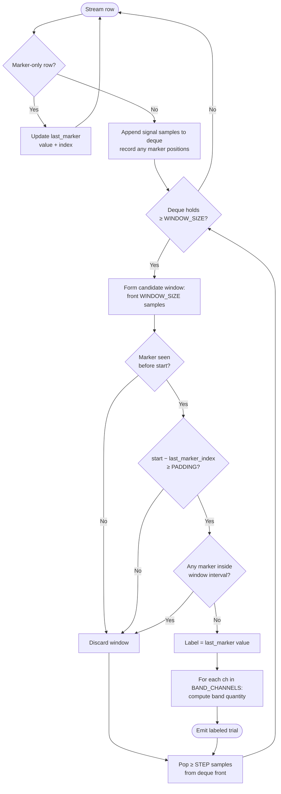

# Band Extractor — Problem Specification

## Overview

The **Band Extractor** converts a continuous, timestamped EEG data stream into discrete, labeled trial windows suitable for classifier training and evaluation. Each trial window undergoes a band-power calculation across a fixed subset of EEG channels. The label assigned to a trial is derived from the **most recent marker** observed in the stream prior to (or at) the trial's extraction point.

## Input Data Stream

The stream is a sequence of rows, each containing:

- a **timestamp**
- zero or more **signal values** (one per EEG channel, e.g., 8 channels)
- optionally, a **marker value** (a string label such as `"0"`, `"1"`, `"2"`, `"3"`, `"4"`, `"5"`)

Two row types exist:

1. **Signal rows** — contain timestamp + channel samples, no marker.
2. **Marker-only rows** — contain only timestamp + marker (no signal samples).

The majority of rows are signal rows. Markers appear sporadically, interleaved between signal rows.

## Relevant Configuration

| Parameter | Meaning |
|---|---|
| `BAND_WINDOW_SIZE_SEC` / `_SAMPLES` | Length of each extraction window (0.25 s = 62 samples) |
| `BAND_WINDOW_STEP_SEC` / `_SAMPLES` | Hop between consecutive windows (default 1.0 s = 250 samples; live 0.05 s = 12 samples) |
| `BAND_CHANNELS` | Channel indices used for the band calculation (`[2,3,4,5]`) |
| `BAND_CHANNEL_PADDING_SEC` / `_SAMPLES` | Minimum time that must elapse after a marker before a window may *start* (0.1 s = 25 samples) |
| Marker constants | `MARKER_NO_MOVEMENT="0"`, `MARKER_RIGHT="1"`, `MARKER_LEFT="2"`, `MARKER_LEG="3"`, `MARKER_STOP="4"`, `MARKER_FAIL="5"` |

## Sliding-Window Mechanics

The extractor maintains a **sample deque** (per channel, or a deque of row records) fed by the incoming stream. A candidate window is the front `BAND_WINDOW_SIZE_SAMPLES` of the deque. After each candidate is evaluated and emitted, the extractor **pops a minimum of `BAND_WINDOW_STEP_SAMPLES` from the front of the deque** before forming the next candidate.

The word *minimum* matters: if the deque is shorter than a full window at evaluation time, we must wait for more samples to arrive; once a full window is available, we form the candidate, evaluate it, then pop at least `STEP` samples (and top up from the stream as needed). The step is **not** constrained to be ≥ or ≤ the window size — the design must work for:

- `STEP == WINDOW_SIZE` (non-overlapping, contiguous)
- `STEP < WINDOW_SIZE` (overlapping windows — e.g., live mode, 12 vs 62 samples)
- `STEP > WINDOW_SIZE` (non-overlapping with gaps — e.g., default mode, 250 vs 62 samples)

No assumption about the relationship between step and window size may be baked into the logic; the pop-minimum-stride rule handles all three uniformly.

## The Core Problem

For each candidate window we must decide **whether it is valid** and, if so, **what label it carries**. Two constraints govern validity:

### Constraint 1 — Padding after a marker

A window **must not start** within `BAND_CHANNEL_PADDING_SAMPLES` of the most recent marker. For a window starting at sample index `s` with the most recent marker at sample `m` (where `m ≤ s`):

```text
s − m ≥ BAND_CHANNEL_PADDING_SAMPLES
```

This prevents the window from being contaminated by the sensory/visual evoked response immediately following a cue, and ensures the label is unambiguously attributable to the preceding marker.

### Constraint 2 — No marker inside the window

A window **must not contain any marker** in its interval `[s, s + BAND_WINDOW_SIZE_SAMPLES)`. If a marker falls inside the window, the window straddles two label epochs and cannot be assigned a single label. Such windows are **discarded**.

Together, these constraints mean a valid window must lie entirely within the "clean" region of a single label epoch: starting at least `PADDING` samples after the epoch-opening marker and ending strictly before the next marker.

### Label assignment

For a valid window, the label is the **most recent marker value seen at or before the window start** (i.e., the marker that opened the current epoch). `MARKER_STOP="4"` and `MARKER_FAIL="5"` are markers too; the extractor simply propagates whatever the last marker was, leaving downstream consumers to filter which marker values constitute usable classes.

## Process Walkthrough

1. **Stream ingestion** — Rows arrive in timestamp order. Marker-only rows update a `last_marker` register (value + index) but contribute no samples to the deque. Signal rows append samples to the deque and record any marker positions in a parallel structure.
2. **Window availability** — Wait until the deque holds at least `BAND_WINDOW_SIZE_SAMPLES`. The candidate window is the front `WINDOW_SIZE` samples.
3. **Validity check** — For each candidate:
   - Reject if no marker has yet been seen (no label available).
   - Reject if `start − last_marker_index < PADDING`.
   - Reject if any marker index falls in `[start, start + WINDOW_SIZE)`.
4. **Band calculation** — For each channel in `BAND_CHANNELS`, compute the band quantity over the window. Channels outside `BAND_CHANNELS` are ignored.
5. **Emission** — Output a labeled trial: `(window_start_timestamp, label, [band_value_ch1, …, band_value_chN])`.
6. **Advance** — Pop **at least** `BAND_WINDOW_STEP_SAMPLES` from the front of the deque, then return to step 2. The "at least" wording is important: popping exactly `STEP` is the common case, but the loop must tolerate the deque having fewer than `STEP` samples after a partial fill and top up from the stream before the next evaluation.

## Diagram



### Epoch timeline (conceptual)

```text
samples →   m1                 m2                       m3
            │                  │                        │
            │◄── padding ─────►│                        │
            │   (rejected)     │                        │
            │                  │                        │
            │        ┌─────────┴─────────┐              │
            │        │ valid window?     │              │
            │        │ starts ≥ m1+pad   │              │
            │        │ ends < m2         │              │
            │        └───────────────────┘              │
            │                                           │
   ─────────┴──────────────────┴───────────────────────┴────────► time
            epoch(m1)           epoch(m2)                epoch(m3)
            label = m1.val      label = m2.val           label = m3.val
```

### Step vs. window size

```text
STEP > WINDOW_SIZE   (default: 250 > 62)      non-overlapping, gaps
  [window][  gap  ][window][  gap  ][window]

STEP == WINDOW_SIZE  (contiguous)             non-overlapping, no gaps
  [window][window][window][window]

STEP < WINDOW_SIZE   (live: 12 < 62)          overlapping
  [window]
     [window]
        [window]
           [window]
```

The pop-minimum-stride rule makes all three cases a single code path — only the number of samples popped changes.

## Edge Cases & Design Notes

- **No marker yet**: windows before the first marker have no valid label and are discarded.
- **Marker-only rows inside a window interval**: even though they carry no signal samples, they count as markers for Constraint 2 and invalidate any window containing them. Their position is recorded at ingestion.
- **Stop/fail markers**: `"4"` and `"5"` are treated as ordinary markers for epoch boundary and padding purposes; the extractor emits them as labels and leaves class selection to the consumer.
- **Overlap is a configuration choice, not an assumption**: the same validity rules apply whether windows overlap or not. Overlapping windows are individually validated; a rejected window does not affect its overlapping neighbours.
- **Partial deque at stream end**: a trailing partial window (fewer than `WINDOW_SIZE` samples) is not emitted.
- **Popping and validity**: popping happens regardless of whether the candidate was valid or discarded — invalidity only suppresses emission, not the advance. This guarantees termination and a fixed stride through the stream.
- **Gaps / irregular sampling**: because alignment is done in sample indices derived from the stream, timestamp gaps must be reconciled at ingestion (e.g., by index mapping) so that `PADDING` and `WINDOW_SIZE` comparisons remain in consistent units.
- **Minimum pop semantics**: "pop a minimum of `STEP`" is implemented as: if `len(deque) ≥ STEP`, pop `STEP`; otherwise, wait for more stream samples, then pop. This avoids both under-advancing (which would re-emit the same window) and over-advancing (which would skip windows) when the stream feeds in uneven bursts.